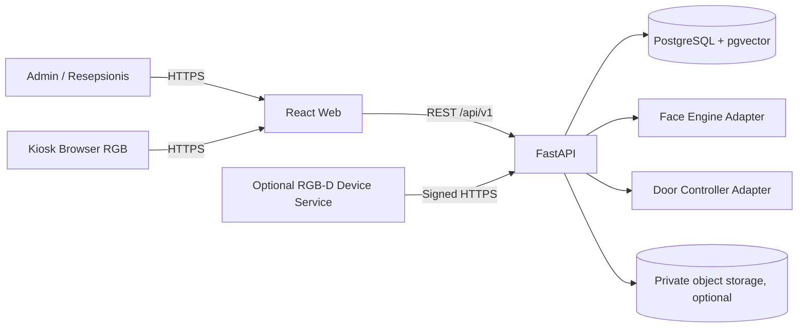

# Arsitektur BISAGYM

## Tujuan

Arsitektur memisahkan aturan membership, orkestrasi check-in, dan implementasi computer vision. Mode mock harus tetap dapat menjalankan demo penuh tanpa kamera, model eksternal, Redis, atau relay pintu.

## Komponen



| Komponen | Tanggung jawab | Tidak boleh dilakukan |
|---|---|---|
| `apps/web` | Admin, resepsionis, enrollment, dan kiosk UI | Menentukan izin akses final atau menerima embedding mentah |
| `apps/api` | Auth, RBAC, membership, consent, check-in, audit, report | Mengikat domain langsung ke satu vendor/model wajah |
| PostgreSQL | Data transaksi, audit, metadata model, dan vector bila tersedia | Menyimpan secret plaintext atau raw capture publik |
| Face engine | Deteksi, kualitas, liveness, embedding, matching | Mengambil keputusan membership |
| Device service | SDK RGB-D, sinkronisasi frame, signing, health | Membuka stream kamera proprietary ke internet |
| Door controller | Relay fisik atau mock | Menerima perintah langsung dari JavaScript browser |

Redis tidak menjadi dependency MVP. Bila ditambahkan, penggunaannya dibatasi untuk rate limit, session singkat, atau heartbeat dan bukan sumber data transaksi utama.

## Alur Request

### Login staf

1. Browser mengirim kredensial ke `POST /api/v1/auth/login` melalui HTTPS.
2. API menerapkan rate limit, memverifikasi password hash dan status user.
3. API mengeluarkan access token singkat serta refresh token/session yang dapat dirotasi.
4. Route berikutnya memverifikasi token dan role di server; penyembunyian menu frontend bukan kontrol otorisasi.
5. Keberhasilan dan kegagalan login dicatat tanpa password atau token.

### Enrollment wajah

1. Operator membuka member dan memastikan persetujuan biometrik aktif serta terversi.
2. API membuat session enrollment berumur pendek.
3. Browser menangkap pose depan, kiri, kanan, dan pose tambahan bila diperlukan.
4. API memvalidasi MIME, ukuran, jumlah wajah, kualitas, pose, dan liveness.
5. Adapter menormalisasi embedding dan menolak outlier; pemeriksaan duplikasi dilakukan dalam cabang yang sama.
6. API menyimpan template dan metadata model, bukan mengirim embedding ke browser.
7. Sample mentah segera dibuang kecuali retention secara eksplisit diaktifkan.
8. Hasil dan identitas operator ditulis ke audit log.

### Check-in kiosk

```text
IDLE -> CAMERA_READY -> FACE_DETECTED -> QUALITY_VALIDATED
     -> LIVENESS_VALIDATED -> EMBEDDING_EXTRACTED -> IDENTITY_MATCHED
     -> MEMBERSHIP_VALIDATED -> ACCESS_GRANTED / ACCESS_DENIED
     -> COOLDOWN -> IDLE
```

1. Kiosk/device meminta session/challenge yang baru.
2. Capture dikirim sekali dengan identitas device dan correlation ID.
3. Face engine mengembalikan fakta biometrik, bukan keputusan akses.
4. Access-control service mengecek member, rentang waktu membership, suspension, cabang, device, dan duplicate cooldown.
5. API menyimpan `checkin_attempt`, reason code stabil, telemetry transisi, dan access event.
6. Respons publik hanya berisi informasi minimum. Skor detail tidak ditampilkan di kiosk.
7. Relay opsional dipicu server melalui `DoorController` setelah keputusan `ALLOW`.

Jika API tidak tersedia, kiosk harus menampilkan sistem tidak tersedia dan tidak boleh fail-open. Fallback dilakukan oleh resepsionis dan tetap diaudit.

## Adapter

Kontrak domain yang perlu tetap dapat diganti:

- `FaceDetector`: lokasi dan jumlah wajah.
- `FaceAligner`: normalisasi pose/crop.
- `EmbeddingExtractor`: vector ternormalisasi beserta versi model.
- `LivenessDetector`: active challenge atau PAD yang lebih kuat.
- `DepthValidator`: validasi variasi kedalaman region wajah.
- `FaceMatcher`: pencarian cosine atau implementasi vector database.
- `DoorController`: mock atau relay melalui service terpercaya.
- Storage adapter: file private lokal atau object storage S3-compatible.
- Device authentication: shared-secret/HMAC awal, dapat diganti asymmetric signing atau mTLS.

Aturan membership hanya memakai hasil terstruktur adapter. Perubahan library/model tidak boleh mengubah reason code bisnis atau melewati consent.

## Data dan Konsistensi

- UUID digunakan sebagai identitas internal; kode member/device adalah identitas bisnis terpisah.
- PostgreSQL adalah database utama dan pgvector digunakan bila adapter vector mengaktifkannya.
- SQLite hanya untuk development/test ringan dan tidak mewakili concurrency atau perilaku pgvector produksi.
- Timestamp disimpan dengan timezone/UTC dan ditampilkan sesuai timezone cabang, default `Asia/Jakarta`.
- Status membership tetap diverifikasi terhadap `start_at` dan `end_at`; kolom status saja tidak cukup.
- Audit log bersifat append-only melalui perilaku API.
- Correlation ID menghubungkan request, check-in, access event, dan log tanpa membawa data biometrik.

## Batas Keamanan

```text
Internet / user device
  |  TLS, CORS eksplisit, auth, upload/rate limit
  v
Reverse proxy / API boundary
  |  network privat, least privilege
  +--> PostgreSQL
  +--> private object storage

Kiosk LAN / RGB-D service
  |  credential per-device, anti-replay, request signing
  v
API device boundary
```

- Browser, payload upload, header forwarding, dan data CSV dianggap tidak tepercaya.
- Database dan object storage tidak diekspos ke internet.
- Admin biasa tidak otomatis mendapat akses konfigurasi biometrik global.
- Secret perangkat berbeda per deployment/perangkat dan harus dapat dirotasi.
- Log, metric, error, dan trace dilarang memuat password, token, raw image, atau embedding.
- Raw capture dinonaktifkan secara default dan tidak pernah disimpan di folder public web.

## Mode RGB dan Depth

| Aspek | RGB MVP | RGB-D opsional |
|---|---|---|
| Capture | Browser `getUserMedia`/mock | Service lokal dengan SDK kamera |
| Data | Frame RGB dan challenge | RGB + depth sinkron + kalibrasi |
| Liveness | Active challenge; bukan PAD sempurna | Active challenge + plausibilitas depth |
| Transport | HTTPS browser ke API | Signed HTTPS/LAN dari device service |
| Ketersediaan | Wajib berfungsi tanpa hardware khusus | Tidak boleh merusak mode RGB saat tidak tersedia |
| Klaim | Pengenalan wajah 2D | Depth-assisted hanya setelah hardware/validasi tersedia |

Landmark 2D dapat membantu pose/liveness, tetapi tidak boleh disebut pengenalan 3D. Detail ancaman dan kalibrasi ada di [biometric-security.md](biometric-security.md).

## Topologi Development

Compose menyediakan `web`, `api`, dan `postgres`. PostgreSQL harus sehat sebelum API start, lalu API harus ready sebelum web start. API container menerapkan migrasi bila konfigurasi Alembic tersedia; seed tetap eksplisit agar restart produksi tidak membuat data demo.
